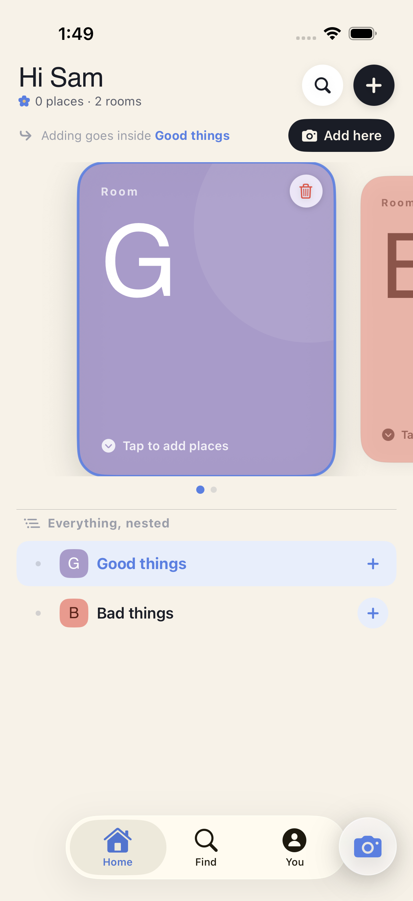
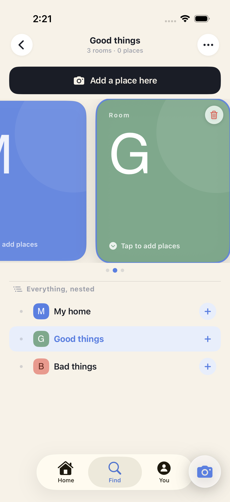
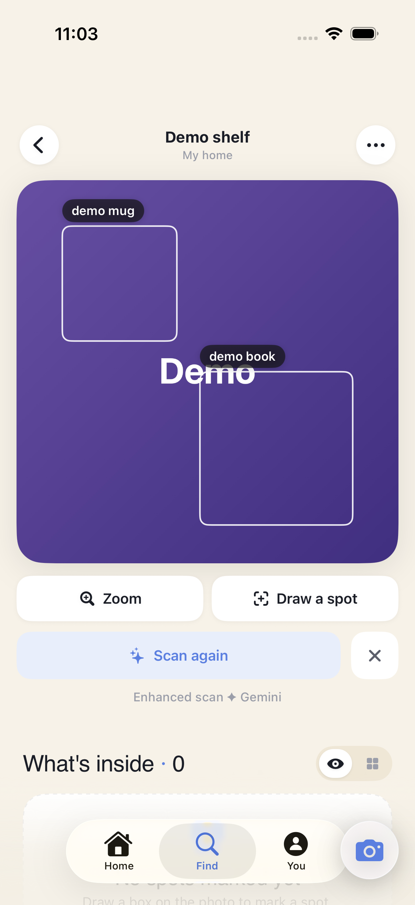

# ForgetMeNote for iOS 🌸

**Remember where things live.** Photograph your rooms, shelves, and drawers — then draw boxes (or trace shapes) right on the photos to map what's inside, recursively: *Living Room → Bookshelf → Top Shelf → that one cable you always lose.* When you need something, search it and jump straight to its picture.

A native SwiftUI port of [zhum/forgetmenote-v2](https://github.com/zhum/forgetmenote-v2) (Android), rebuilt with its own editorial design language — paper tones, serif headlines, and a forget-me-not blue accent.

| Home — your spaces at a glance | Browse — synced photo + tree | AI scan — objects found for you |
|---|---|---|
|  |  |  |

## What it does

- **Nested visual spaces** — every photo can hold sub-spaces drawn as rectangles or freehand-traced outlines, to any depth. A traced shelf crops out of its parent photo and can itself be traced into.
- **Two-pane browsing** — a swipeable photo carousel stays in lock-step with an indented hierarchy tree, so you always know where you are in your home.
- **Find anything** — search by name, tag, or notes (`#cables` searches only tags); tapping a result jumps directly to the matching room, picture, or sub-picture.
- **AI object scanning, two tiers:**
  - **On-device (default):** Apple Vision instance-segmentation masks fused with ML Kit detection — private, offline, free, drawn as glowing silhouettes you can tap to turn into sub-spaces.
  - **Enhanced (optional, also free):** a guided in-app flow provisions a free Gemini API key (Google AI Studio, no credit card); scans then return more objects with specific names ("blue ceramic mug"), with automatic fallback across the Gemini Flash family when a model is overloaded — and back to on-device if the cloud is unreachable.
- **Auto-naming** — freshly captured photos get an on-device ML name suggestion.
- **Quality-of-life** — tap-and-hold any room icon to delete it, recent searches, app-icon badge for refreshed items, haptics throughout, walkthrough tour, export/import as zip.

## How it's built

| Layer | Tech |
|---|---|
| UI | SwiftUI (iOS 17+), custom v3 design system (`V3Theme`, Instrument Serif type ramp) |
| Data | SwiftData `@Model`s mirroring the Android Room v12 schema; `@ModelActor` repository |
| Vision | Apple Vision + ML Kit fusion on-device; Gemini 2.5 Flash via REST for enhanced scans |
| Nav | Single shared flattened tree model driving carousel + hierarchy in lock-step |
| QA | XCTest unit suite + Maestro end-to-end flows, including a mocked-Gemini E2E that proves the full cloud pipeline offline |

## Build it

```bash
brew install xcodegen cocoapods
cd ios
xcodegen generate                                   # project.yml → .xcodeproj
LANG=en_US.UTF-8 pod install                        # ALWAYS after xcodegen
open ForgetMeNote.xcworkspace                       # the workspace, not the project
```

Simulator builds skip the device-only ML Kit pods: `SKIP_MLKIT=1 pod install`.
The initial XcodeGen pass allows missing CocoaPods xcconfigs because `pod install`
creates them afterward. Subscription screens are local prototypes; the unused
RevenueCat SDK has been removed until real products/offerings are integrated.

Run the QA suite (Simulator):

```bash
# These flows clear app data. Select a disposable simulator with --device UDID.
maestro --device SIMULATOR_UDID test ios/qa/maestro/flows/v3_full_qa.yaml
maestro --device SIMULATOR_UDID test ios/qa/maestro/flows/v3_search_qa.yaml
# Gemini pipeline E2E against a local mock server:
python3 ios/qa/mock_gemini_server.py &
maestro test ios/qa/maestro/flows/v3_gemini_scan.yaml
```

More detail: [docs/DEVELOPMENT.md](docs/DEVELOPMENT.md) (build modes, device install, project layout).

### Focused search verification

`SearchFilterTests` covers name, note, plain-tag and `#tag` queries, empty input,
and pasted newlines; `V3SearchDestinationTests` covers result routing. Run these
without the separate cloud integration suites:

```bash
cd ios
xcodebuild -workspace ForgetMeNote.xcworkspace -scheme ForgetMeNote \
  -destination 'platform=iOS Simulator,id=SIMULATOR_UDID' \
  -only-testing:ForgetMeNoteTests/SearchFilterTests \
  -only-testing:ForgetMeNoteTests/V3SearchDestinationTests test
```

The search Maestro flow uses simulator-only demo flags and a generated local
photo, so it can check first-use guidance, search results, long-query recovery,
and room navigation without camera access or a model provider. The smoke flow
checks the current nested browser and the accessible walkthrough Skip button.

## Credits

Original concept and Android app by [Sergey (zhum)](https://github.com/zhum) — this is a ground-up native iOS interpretation that stays data-model compatible while exploring its own look and an on-device-first approach to AI scanning. Built collaboratively with Claude Code.
